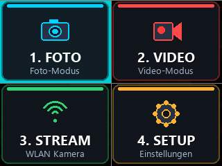
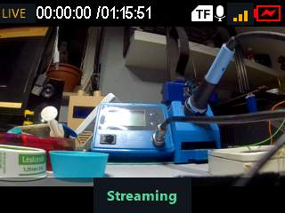
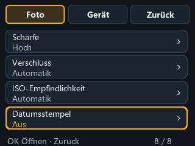
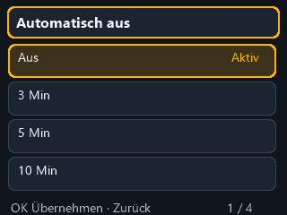
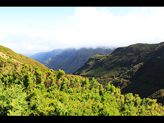
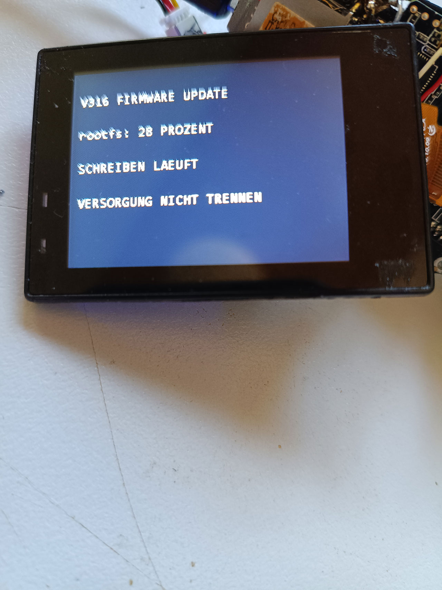

# Allwinner V316 Cam: Recovery und eigenständige Firmware

| Vier-Kachel-Menü | Livebild im Streaming-Modus |
| --- | --- |
|  |  |
| **Foto-Setup** | **Untermenü mit aktivem Wert** |
|  |  |
| **Welcome-Bild** | **Abschaltbild** |
|  |  |
| **Firmwareupdate von SD** | **Updateablauf** |
|  | Paket auf FAT32-SD kopieren, per USB starten und **OK/Auslöser zwei Sekunden halten**. Die Kamera schreibt aus dem RAM, prüft durch vollständiges Rücklesen und startet neu. [Vollständige Anleitung und Testergebnis](docs/SD_UPDATE.md). |

Das Hauptmenü und das Streamingbild wurden am 31.10.2026 direkt von der Kamera
aufgenommen. 
Das Foto des laufenden SD-Updates stammt vom erfolgreichen Gerätetest am 01.11.2026.
Die Setup-/Untermenü-Screenshots dokumentieren die Menüüberarbeitung vom
28.10.2026. Start- und Abschaltbild sind PNG-Vorschauen der installierten BMPs.

Stand: **01.11.2026**. Dokumentation und Werkzeuge für das reparierte Board
mit 16-MiB-Fudan-SPI-Flash (`a1 40 18`). Die ausgelesene SoC-Kennung wird
von **sunxi-fel als Allwinner V536 interpretiert**. 

Die Kamera startet vollständig aus dem internen Flash. Die SD-Karte ist
ausschließlich Medienlaufwerk; App, Menüs, Übersetzungen, Bilder, WLAN und
Streaming benötigen keine Systemdateien auf SD.

## Ausgangspunkt: Kamera bleibt bei „Welcome“ stehen

Das Hauptproblem war zunächst, überhaupt wieder Zugriff auf die Kamera zu
bekommen. Sie zeigte nur das Welcome-Bild und erreichte keine bedienbare
Kameraoberfläche. Eine passende Originalfirmware war für die Kamera nicht mehr
verfügbar. Ein Image einer ähnlichen Kamera diente deshalb als Ausgangspunkt
für die Rekonstruktion einer auf diesem Board funktionierenden Firmware.

Ein konkreter Stolperstein war der **offenbar umgelabelte Flashchip**:
Auf dem Gehäuse steht Winbond, elektronisch meldet er jedoch die
Fudan-Kennung `a1 40 18`. Der Kernel des Ersatzimages erwartete die
Winbond-Kennung `ef 40 18` und musste deshalb an den tatsächlich erkannten
Flash angepasst werden. Anschließend wurden der Kernel neu gepackt und
die uImage-Prüfsummen neu berechnet. „Umgelabelt“ beschreibt hier den
Widerspruch zwischen Aufdruck und ausgelesener Kennung.

Ein ähnliches Gehäuse oder derselbe SoC reicht dafür nicht aus: Bootloader,
Flash-Erkennung, Kernel, Sensor-/Displayansteuerung und Konfiguration müssen
zum konkreten Board passen. Die Arbeit bestand deshalb zuerst aus Zugang,
Sicherung, Analyse und Anpassung – erst anschließend aus neuen Menüs und
zusätzlichen Funktionen. Ein sichtbares Welcome-Bild allein belegt noch
keinen erfolgreich gestarteten Linux-Unterbau oder eine laufende Kamera-App.

Anmerkung: Die hier beschriebene Demontage und der Zusammenbau sowie die softwaretechnischen
Versuche können die Kamera unwiederbringlich zerstören, so dass sie nicht 
mehr verwendet werden kann. Der hier beschriebene Weg, die Kamera zu retten 
und die Firmware zu verändern dient ausschließlich Entwicklungs- und Schulungszwecken.

## Zerlegen und Zusammenbauen

Das Auseinanderbauen ging bei dieser Kamera noch einigermaßen gut. Der
Zusammenbau war dagegen eher „Horror“: Hauptprobleme bei der kleinen Kamera waren 
verwendete Folientaster und ihre Plastedrücker. Die müssen exakt wieder so eingebaut werden.
Die Folientaster sind empfindlich und gehen schnell kaputt.
Schon eine ungünstige Ausrichtung der Drücker macht die Bedienung unzuverlässig.
Das war eine praktische Schwierigkeit dieser Reparatur, unabhängig davon,
ob die Firmware bereits wieder funktionierte. Beim Zusammenbau deshalb
die Position und Funktion der Knöpfe vor dem endgültigen Schließen prüfen.

## Unsere Zugangs- und Flash-Werkzeuge

| Hilfsmittel | Verbindung | Wofür wir es verwenden |
| --- | --- | --- |
| **FEL-Modus** | BootROM der Kamera über deren USB-Datenanschluss | Rettungszugang unabhängig vom normalen Linux-/App-Start; Eintritt über den identifizierten FEL-Kontakt |
| **sunxi-fel** aus sunxi-tools | PC ↔ Kamera im FEL-Modus | SoC/Flash erkennen, vollständige SPI-Sicherungen lesen, passendes Image schreiben und vollständig zurücklesen |
| **USB-UART-Modul** | Serielle Boardanschlüsse GND, TX und RX; am PC COM11 | Bootmeldungen beobachten und bei laufendem Linux mit der Root-Shell arbeiten; 115200 Baud, 8N1, kein Flow Control |
| **PuTTY** | PC-Terminal auf dem COM-Port des UART-Moduls | Bootprotokoll mitlesen und Shellbefehle eingeben; PuTTY selbst ist kein SPI-Flashprogramm |
| **Python-/UART-Werkzeuge im Repository** | Derselbe serielle Zugang | Wiederholbare Diagnose, Dateiabgleich und Wartung statt manueller Terminaleingaben |

Es sind **zwei getrennte Verbindungen**: Das UART-Modul verschafft uns die
serielle Konsole; das USB-Datenkabel direkt an der Kamera ermöglicht FEL.
Ein erkannter COM-Port bedeutet nicht, dass die Kamera im FEL-Modus ist.
Umgekehrt braucht sunxi-fel keine funktionierende Linux-Shell.
Um nicht jedes Mal am Flashbaustein ein Kabel für den FEL Zugang zu löten, wurde
beschlossen in das Gehäuse einen kleine Buchse mit 4 Anschlüssen für einen Mini-Stecker 
zu einzufügen. Die Anschlüsse sind TX,RX, FEL und GND. Die Anschlüsse wurden mit kleinen Drähten 
direkt auf dem Board an die entsprechenden Pins gelötet.
Anmerkung: Während der ganzen Tests kam es teilweise immer wieder dazu,
dass FEL benötigt wurde um eine vorhandene Firmware wieder aufzuspielen,
weil irgendwas nicht mehr softwaretechnisch reparierbar war.

Zwar gab es diesen Ablauf: zuerst Zugang und Sicherung herstellen, im FEL-Modus zweimal
vollständig lesen und vergleichen, das geprüfte Image schreiben und danach
den gesamten Flash zurücklesen. Erst nach identischer Prüfsumme folgt der
normale Start mit Kontrolle über UART/PuTTY. Details und Anschlussfotos:
[Recovery-Anleitung](docs/RECOVERY.md). Hintergrund zum Werkzeug:
[sunxi-fel-Handbuch](https://github.com/linux-sunxi/sunxi-tools/blob/master/sunxi-fel.1).
Das hat aber manchmal auch nicht zu 100% funktioniert.

### Voraussetzungen am Windows-11-PC

Ein normaler Windows-11-PC genügt; ein separater Spezialrechner ist nicht
nötig. Für diesen Ablauf wurden weder WSL noch eine virtuelle Maschine
benötigt. Wichtiger als hohe Rechenleistung sind zuverlässige USB-Verbindungen
und die passenden Treiber.

| Aufgabe | Benötigt |
| --- | --- |
| Wiederherstellung/Flashen | `sunxi-fel` für Windows, passender libusb-kompatibler FEL-USB-Treiber, USB-Datenkabel direkt zur Kamera, eigener Speicherplatz für mehrere 16-MiB-Sicherungen |
| Bootmeldungen und Shell | USB-UART-Modul mit passenden Logikpegeln, dessen Windows-Treiber, PuTTY oder unsere Python-UART-Werkzeuge; hier COM11 mit 115200 Baud/8N1 |
| Python-Werkzeuge | Python 3 und die Pakete aus `requirements.txt` (`Pillow`, `pyserial`) |
| App-/Ressourcen-Build | Arm GNU Toolchain arm-none-eabi 13.3 rel1, Segoe UI und die geprüften Binärbasen |
| Komplettimage bauen | SquashFS-Tools mit XZ sowie Symlink-/Pseudo-Datei-Unterstützung; getesteter Windows-/Cygwin-Build 4.3 |
| Streaming-Quellen neu bauen | Zusätzlich Zig 0.14.1; für das bloße Flashen eines fertigen Images nicht erforderlich |

PuTTY und sunxi-fel müssen Zugriff auf ihre jeweilige Verbindung haben;
ein serieller COM-Port sollte nur von einem Terminal/Werkzeug gleichzeitig
geöffnet werden. Konkrete Build-Eingaben und Pfade stehen in
[BUILD.md](docs/BUILD.md), der sichere Flash-Ablauf in [RECOVERY.md](docs/RECOVERY.md).

### Hätte eine besser abgesicherte Kamera das falsche Image verhindert?

Ein regulärer Updateweg kann mit Modell-/Versionsprüfungen und
kryptografischen Signaturen ungeeignete oder nicht autorisierte Firmware
abweisen. Eine entsprechend abgesicherte Bootkette kann außerdem das
Starten nicht vertrauenswürdiger Images verhindern; siehe
[U-Boot Verified Boot](https://docs.u-boot.org/en/stable/usage/fit/verified-boot.html).

Der FEL-/SPI-Weg ist jedoch ein tiefer Rettungszugang und kein gewöhnliches
Kamera-Menüupdate. Beim getesteten Board konnte darüber ein komplettes
Image geschrieben werden. Daraus folgt weder, dass jede teurere Kamera solche Zugriffe
blockiert, noch dass ein offener Rettungszugang allein ein Qualitätsmangel
ist – er hat diese Reparatur erst ermöglicht. Für dieses Projekt waren vor
allem die fehlende passende Originalfirmware und die Unterschiede zwischen
scheinbar ähnlichen Kameras das Problem. Ein pauschales Urteil über alle
Hersteller oder Preisklassen lässt sich daraus nicht ableiten.

## Heute: neue Menüs und Hauptfunktionen

Die Kamera öffnet nach dem Start das neue Vier-Kachel-Menü. **FOTO** und
**VIDEO** führen zu den jeweiligen Aufnahmearten und lokalen Einstellungen;
beim Wechsel dorthin wird WLAN abgeschaltet. **STREAM** aktiviert WLAN und
den Browser-Livestream; die Aufnahmeauslösung ist in diesem Zustand gesperrt.
**SETUP** öffnet die überarbeiteten Kamera-/Geräteeinstellungen mit deutschen
Texten, einheitlichen Listen, Dialogen und klarer Auswahlmarkierung.

App, Menübilder, Übersetzungen, Start-/Abschaltbilder und Streaming liegen
jetzt im internen Image. Die Kamera kann ohne SD ins Menü starten und streamen.
Eine leere SD wird erst für Fotos und Videos gebraucht; ein Kopieren von
Systemdateien auf die Karte ist nicht mehr nötig. Die folgende Liste nennt
den tatsächlich geprüften Umfang, nicht nur geplante Funktionen.

## Geprüfter Funktionsstand

- Vier Kacheln: **FOTO · VIDEO · STREAM · SETUP**, automatischer Menüstart.
- Deutsche Menüs, einheitliches Setup und korrigierte Moduskacheln.
- „Flimmerreduzierung“ statt „Netzfrequenz“; sichtbare Fototexte mit „Foto“.
- Eigene Start-/Abschaltbilder: 320 × 240 Pixel, unkomprimiertes 24-Bit-BMP.
- Kaltstart, Menüs und WLAN/Livebild **ohne SD-Karte** geprüft.
- Webplayer mit Start/Pause, Vollbild, Bildrate und JPEG-Qualität.
- Foto und kurzes Video auf leerer Medien-SD aufgenommen und vollständig
  dekodiert; anschließend wieder funktionierendes Livebild.
- Betrieb während dieser Prüfung über externe Versorgung ohne Akku.
- **SD-Firmwareupdate:** Paket auf SD, beim Start OK/Auslöser zwei Sekunden
  halten. Schreiben aus dem RAM, vollständige Rückleseprüfung und Neustart
  am 01.11.2026 erfolgreich getestet; Einstellungen und WLAN bleiben erhalten.
  [Anleitung und Grenzen](docs/SD_UPDATE.md). FEL bleibt der Rettungsweg.

Der Stream zeigt die Display-Vorschau mit 320 × 240 Pixeln. **Das Display
muss angeschlossen sein:** Ohne Display lieferte der getestete Aufnahmeweg
schwarze Bilder. Native Album-Bedienung, Tonqualität und alle weiteren
Aufnahme-Untermodi sind nicht separat geprüft.

Die Streaming-Optimierung vom 01.11.2026 erreicht bei JPEG-Qualität 65 etwa
**16–17 statt zuvor 11–12 Bilder/s**. Im Webplayer dazu die experimentelle
Obergrenze 25 wählen; 15 bleibt der Standard. Echte 25 Bilder/s werden noch
nicht erreicht. [Messungen und Aufnahmeprüfung](tools/streaming/README.md).

[Aktueller Stand](docs/INTERNES_IMAGE_2026-10-31.md) ·
[Bauen](docs/BUILD.md) · [Sichern und Wiederherstellen](docs/RECOVERY.md).

In Arbeit: [WLAN-Zugangsdaten einmalig von SD übernehmen](docs/WLAN_IMPORT.md).
Parser und bestehende Verbindung sind geprüft; Bestätigung, DHCP und Rückfall
benötigen noch Gerätetests. Der automatische Import ist bis dahin deaktiviert.

Neue Hardwarefotos: [UART-/FEL-Anschlüsse](pictures/zus%C3%A4tzliche-anschl%C3%BCsse.jpg),
[FEL-Nahaufnahme](pictures/FEL.jpg), [Antennenanschluss](pictures/Antennenanschluss.jpg).

## Repository

| Pfad | Zweck |
| --- | --- |
| `tools/ui_theme/` | Aktueller Renderer, Übersetzungen, Ressourcen-Builder |
| `tools/streaming/` | Streaming-/Webquellen; Legacy-SD-Installer |
| `tools/build_internal_image.py` | Internes 16-MiB-Image bauen |
| `tools/sd_update/` | Auf diesem Board geprüfter SD-Updater mit Bestätigung und Rückleseprüfung: [Stand und Anleitung](docs/SD_UPDATE.md) |
| `tools/verify_internal_image.py` | Dateisystem, Bibliotheken und XZ prüfen |
| `tools/camera_uart.py`, `tools/sh.py`, `tools/logger.py` | UART-Zugang |
| `tools/capture_runtime.py`, `tools/backup_internal.py` | Private Sicherungen |
| `firmware/sdvcam/` | Nur die zwei benötigten App-Build-Basen |
| `firmware/ui_theme/` | Bisheriger öffentlicher SD-App-/Ressourcenstand |
| `firmware/splash/` | Vorbereitete Start-/Abschaltbilder |
| `firmware/V316CM_WORKING_FULL_IMAGE_16MB.bin` | Ältere funktionierende **Rettungsbasis**, nicht das neue Komplettimage |
| `firmware/kernel_rodata_exact.uImage` | Kernel mit passender Flash-Erkennung |
| `hardware/`, `pictures/`, `custom_ui/` | Hardwarebelege, Menübilder, Kacheln |

Das neue getestete Komplettimage enthält gerätespezifische WLAN-Daten und
bleibt lokal. Es ist kein öffentliches Universalimage. Die Build-Anleitung
beschreibt die benötigten eigenen Eingabedateien.

## Flash-Aufteilung

| Offset | Größe | Bereich |
| --- | --- | --- |
| `0x000000` | 1 MiB | Bootloader |
| `0x100000` | 3 MiB | Kernel |
| `0x400000` | 10,5 MiB | RootFS, jetzt XZ-SquashFS |
| `0xE80000` | 512 KiB | Einstellungen/JFFS2 |
| `0xF00000` | 128 KiB | U-Boot-Umgebung |
| `0xF20000` | 384 KiB | Startbild |
| `0xF80000` | 512 KiB | UDISK |

Das neue RootFS belegt 9.924.608 Byte und passt ohne neue Partitionierung.
Die ursprüngliche Kernelkorrektur ersetzt die fest eingetragene
Winbond-Erkennung `ef 40 18` durch die zum Board passende ID `a1 40 18`;
Kernel- und uImage-Prüfsummen werden neu aufgebaut.

## Bereinigung und Lizenz

Alte Probeprogramme, Zwischen-Binaries, Rohlogs, Chatkopien und überholte
Statusberichte wurden entfernt. Sie bleiben über die Git-Historie verfügbar.
Aktuelle Build-Abhängigkeiten und Rettungsbasen bleiben erhalten. Private
Sicherungen, Zugangsdaten und Testaufnahmen gehören nicht ins Repository.

Unabhängiges Reparatur-/Interoperabilitätsprojekt, nicht mit Allwinner
verbunden. Eigene Werkzeuge/Dokumentation: [MIT](LICENSE). Linux: GPLv2;
Fremdkomponenten behalten ihre jeweiligen Lizenzen. Die MIT-Lizenz ist keine
Neulizenzierung der herstellerspezifischen Firmwarebestandteile.
