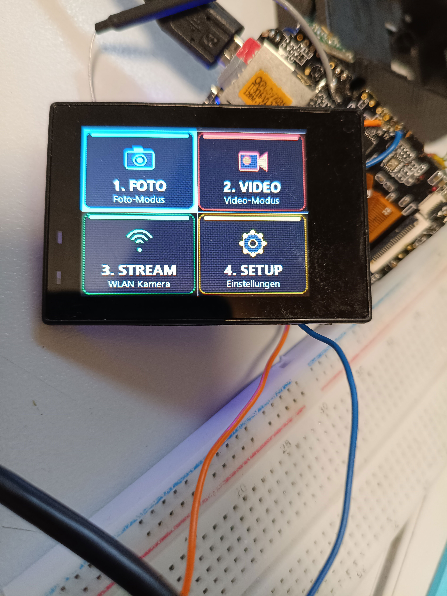

# Allwinner V316 Action Camera Unbrick & SPI Flash Recovery (`v316-cam-unbrick`)

Recovery guide, firmware images, patch tools, and hardware documentation for **Allwinner V316 (sun8iw16)** based action cameras (such as Allwinner V316 Cam, Sunchip DV002).

---

## 🔍 The Problem & Root Cause

Many V316 action cameras (e.g. Allwinner V316 Cam) experience a boot hang or panic ("Uncompressing Linux... done, booting the kernel") if:
1. An incorrect or generic firmware was flashed.
2. The onboard SPI Flash chip is a **Fudan Micro FM25Q128** (JEDEC ID `a1 40 18`), but the stock kernel image only had the driver for **Winbond W25Q128** (`ef 40 18`) hard-coded into `vmlinux`.
3. When the Linux kernel booted, it could not identify the MTD flash partitions, causing rootfs mounting failure or silent boot stalls.

### 💡 The Solution
- Extracted and decompressed `vmlinux` from the stock kernel uImage.
- Binary-patched the SPI Flash JEDEC ID check at offset `0x51d2d4` from `ef 40 18` (Winbond) to `a1 40 18` (Fudan).
- Re-compressed with 7-Zip (`-mx=9 -mfb=258 -mpass=15`), preserved exact rodata offsets.
- Recalculated CRC32 headers and reassembled a fully working U-Boot `uImage`.
- Created a complete, verified **16 MB raw SPI Flash binary image** ready to write with an external programmer (e.g. CH341A) or sunxi-fel.

---

## 📁 Repository Structure

```
v316-cam-unbrick/
├── firmware/
│   ├── V316CM_WORKING_FULL_IMAGE_16MB.bin  # Ready-to-flash 16MB SPI Flash image
│   └── kernel_rodata_exact.uImage          # Working uImage with Fudan ID patch
├── tools/
│   ├── patch_flash_kernel.py               # Automated kernel patch & pack tool
│   ├── logger.py                           # Serial UART logger tool
│   ├── patch_autostart.py                  # Applies the boot-autostart hooks
│   ├── fbgrab.py                           # Framebuffer → ASCII (quick screen check)
│   ├── fbshot.py                           # Framebuffer → PNG (pixel-exact screenshot)
│   └── set_screensaver.py                  # Disables the auto screen blanking
├── pictures/
│   ├── new-menue.jpg                       # The finished 4-tile menu on the device
│   ├── welcome.jpg                         # Boot / welcome screen
│   ├── usb.jpg                             # USB mass-storage popup
│   ├── wires.jpg                           # UART wiring on the breadboard
│   └── allwinner.jpg                       # Allwinner V316 SoC close-up
├── hardware/
│   ├── Platine1.jpg                        # PCB front overview & components
│   ├── Platine2.jpg                        # PCB rear & test pads
│   └── V316-main-PCB.jpg                   # Mainboard layout & pin assignments
├── custom_ui/                              # Custom tiles & German labels (SD card)
├── docs/
│   ├── AUTOSTART.md                        # How the menu opens itself at boot
│   ├── STATUS_AND_NAVIGATION.md            # Button findings & menu analysis
│   ├── allwinner-V316-firmware-structure.txt # Flash partition offsets & MTD map
│   └── live_uart.log                       # Proof-of-boot serial log (Linux 4.9)
├── .gitignore
├── LICENSE
└── README.md
```

### The 4-tile menu



Four tiles in a 2×2 grid: **1. FOTO**, **2. VIDEO**, **3. STREAM** (WiFi camera),
**4. SETUP**. The menu opens by itself ~1 s after boot — see
[docs/AUTOSTART.md](docs/AUTOSTART.md).

---

## 🗺️ Flash Memory Layout (16 MB SPI NOR Flash)

| Hex Offset | Size (Bytes) | Description | Device Node |
| :--- | :--- | :--- | :--- |
| `0x000000` | 1,048,576 (1 MB) | Bootloader (U-Boot + SPL) | `/dev/mtdblock0` |
| `0x100000` | 3,145,728 (3 MB) | Linux Kernel (`uImage`) | `/dev/mtdblock1` |
| `0x400000` | 11,010,048 (~10.5 MB) | System RootFS (`squashfs`) | `/dev/mtdblock2` |
| `0xE80000` | 524,288 (512 KB) | Configuration (`jffs2`) | `/dev/mtdblock3` |
| `0xF00000` | 131,072 (128 KB) | Env / Metadata | `/dev/mtdblock4` |
| `0xF20000` | 393,216 (384 KB) | Boot Logo Bitmap | `/dev/mtdblock5` |
| `0xF80000` | 524,288 (512 KB) | User Disk / Extra Space | `/dev/mtdblock6` |

---

## ⚡ How to Flash the Camera

### Option A: External Hardware Programmer (CH341A / SOIC8 Clip)
1. Connect a 3.3V SPI programmer (like CH341A or Raspberry Pi) to the FM25Q128 SOP-8 chip (or desolder if in-circuit power leakage prevents read/write).
2. Read and backup your current chip content:
   ```bash
   flashrom -p ch341a_spi -r backup_original.bin
   ```
3. Write the working full image:
   ```bash
   flashrom -p ch341a_spi -w firmware/V316CM_WORKING_FULL_IMAGE_16MB.bin
   ```

### Option B: FEL Mode (USB Recovery via sunxi-tools)
If the camera is recognized in FEL mode (`1f3a:efe8`):
```bash
sunxi-fel -p spiflash-write 0 firmware/V316CM_WORKING_FULL_IMAGE_16MB.bin
```

---

## 🔌 UART Debug Connection

- **Baud Rate:** `115200`
- **Settings:** `8N1`, No flow control
- **Pads:** Check `hardware/V316-main-PCB.jpg` and `hardware/Platine1.jpg` for TX/RX test pads.

A successful boot will output logs ending with MiniGUI launching and presenting the interactive shell:
```
[    0.000000] Booting Linux on physical CPU 0x0
[    0.000000] Linux version 4.9.118 (gcc version 5.3.1)
...
[  10.893844] read descriptors
[fangjj]: bmp_path=:[/usr/share/minigui/res/images/function_mode.png]
/ #
```
(See [docs/live_uart.log](docs/live_uart.log) for the complete reference log.)

---

## 🛠️ Rebuilding / Patching the Kernel

To run the automated patch script yourself:
```bash
python tools/patch_flash_kernel.py
```
*(Requires Python 3 and 7-Zip installed at `C:\Program Files\7-Zip\7z.exe` or update the path in the script)*.

---

## ⚖️ Legal Disclaimer & Trademark Notice

- **Fair Use:** "Allwinner", "Allwinner V316 Cam", and "Allwinner" are trademarks of their respective owners. Their use in this repository is strictly for identification, interoperability, educational, and device repair / unbricking purposes under Nominative Fair Use principles.
- This repository is an independent open-source hardware unbricking documentation project and is not affiliated with, sponsored by, or endorsed by Allwinner or Allwinner Technology.
- **Licenses:**
  - Tools, scripts, and documentation: [MIT License](LICENSE).
  - Linux Kernel modifications: GNU GPL v2.
