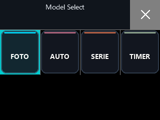
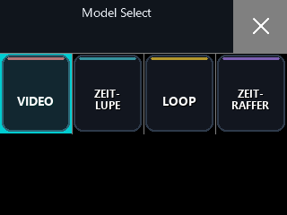

# Allwinner V316 Cam: Gerätestand vom 30.10.2026

## Foto- und Videomodi: doppelte Beschriftungen behoben

Auf der laufenden Kamera zeigten die Moduskacheln zwei Beschriftungen:
Der deutsche Name war bereits Teil des PNG-Bildes, während die native
IconView darunter zusätzlich einen Namen aus der aktiven Sprache zeichnete.
Beispiele waren `FOTO` / `Photo`, `AUTO` / `Auto`, `SERIE` / `Burst` sowie
`ZEIT-LUPE` / `Slowly`.

Die aktuelle App mit MD5 `21e4c410b7ae80a5c338d659bc08262d` unterdrückt nur
diese zusätzlichen IconView-Beschriftungen. Die Kachelbilder und die
Beschriftungen in Vorschau und Einstellungen werden nicht verändert.
Der vorhandene v22-Filter für die vier Foto- beziehungsweise vier Videomodi
bleibt aktiv; sein impliziter Instanzparameter in `r4` wird im Wrapper gesichert.

Die folgenden Bildschirmbilder wurden nach der Installation direkt aus dem
Framebuffer der Kamera gelesen:





## Installation und Prüfung

- Aus `sdvcam_menu_v22` mit dem lokalen Theme-Builder neu erzeugt; alle
  ersetzten Binärstellen werden gegen die erwarteten Bytes geprüft.
- Vorheriger funktionierender Stand:
  `4614a61766519e17a778c914956c8ff9`.
- Sicherung auf der SD-Karte:
  `/mnt/extsd/ui_theme/startup-20261030-175710-backup`.
- Installierte App und beide SD-Appdateien hatten anschließend dieselbe
  Zielprüfsumme; die Theme-Aktivierungsdatei enthält diese ebenfalls.
- Foto- und Videoauswahl aufgerufen, alle acht sichtbaren Kachelbeschriftungen
  geprüft und das Vier-Kachel-Hauptmenü zusätzlich visuell kontrolliert.
- In Foto/Video war WLAN einschließlich der WLAN-Schnittstelle ausgeschaltet.
  Nach Rückkehr zu STREAM antwortete HTTP und der Stream lieferte zwölf
  unterschiedliche, vollständig dekodierbare JPEGs mit 320 × 240 Pixeln.
- Es wurde keine Aufnahme ausgelöst. Die Prüfung betrifft die Darstellung
  und den Wechsel zwischen Foto, Video und Streaming; eine Aufnahmeprüfung
  aller acht Untermodi und ein neuer Kaltstart sind nicht Teil dieses Tests.

Die Installation aktualisiert die SD-App und ihre Aktivierungsprüfsumme.
Die Flash-Partitionen wurden nicht geschrieben. Die lokalen Rettungsdateien
vom 29.10. bleiben der damalige Sicherungsstand; sie enthalten diesen neuen
Kachel-Fix noch nicht.

Reproduktion und Installation auf dem genannten Ausgangsstand:

```powershell
python tools/ui_theme/build.py
python -u tools/ui_theme/deploy_startup.py --base-md5 4614a61766519e17a778c914956c8ff9
```

## WLAN mit der ersetzten Antenne

Die Kamera wurde über COM11 mit 115200 Baud geprüft. Nach Aktivieren von
STREAM verband sie sich mit dem gespeicherten 2,4-GHz-Netz. Beim ersten
Antennentest lagen die RSSI-Werte zwischen −45 und −47 dBm, die ausgehandelte
Linkrate stieg auf 65 Mbit/s. Zehn Ping-Anfragen wurden ohne Verlust beantwortet;
HTTP und Livevideo waren erreichbar. Bei späteren Prüfungen wurden etwa
−52 bis −56 dBm gemeldet.

Das sind Messungen am jeweiligen Standort, kein Vergleich zur alten Antenne
und keine Reichweitenmessung. WLAN-Zugangsdaten und gerätespezifische
Sicherungen bleiben lokal.

## Taster nach dem Zusammenbau

Im ersten Test kamen von beiden Seitentasten Druck- und Loslassereignisse
über `event0` an, die auch die App empfing. Von OK und Vordertaste wurde in
diesem Testfenster kein Ereignis gesehen. Der Nutzer meldete fehlenden
Druckpunkt und kündigte erneutes Öffnen der Kamera an. Eine abgeschlossene
mechanische Reparatur oder ein anschließender vollständiger Tastentest ist
damit nicht belegt.
