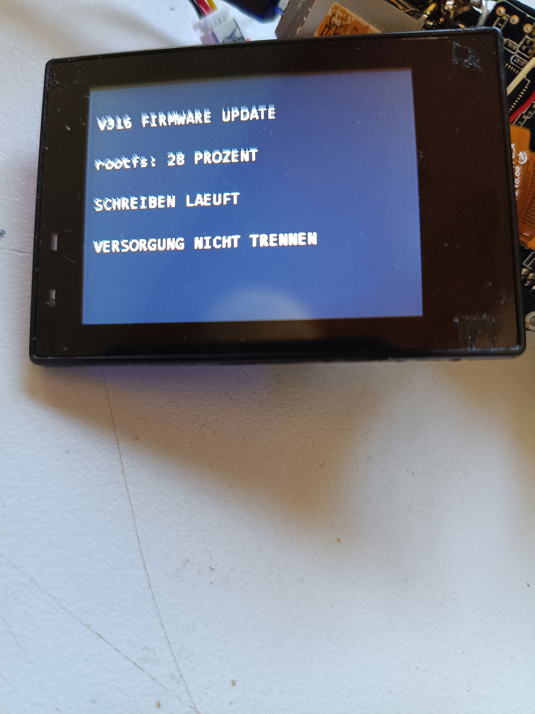

# Firmware-Update von SD

**Stand 01.11.2026: echtes SD-Update auf diesem Board erfolgreich geprüft.**
Die Kamera hat das Paket beim Start erkannt, die Tastenbestätigung ausgewertet,
das interne System aus dem RAM geschrieben und vollständig zurückgelesen.
Auch nach dem Neustart stimmt die Systempartition exakt mit dem Image überein.
Bootloader, Bootumgebung, UDISK, WLAN und alle 128 Einstellungswerte blieben
erhalten. Der Updater ist jetzt im internen Image installiert. FEL bleibt
der Rettungsweg, wenn die bisherige Firmware nicht mehr startet.

Der Updater gehört in den internen Flash. Auf einer normalen Medienkarte
sind weiterhin keine Systemdateien nötig. Nur für ein Update wird ein
speziell verpacktes Image im Hauptverzeichnis der Karte abgelegt.



Das Foto vom 01.11.2026 zeigt den tatsächlichen Schreibvorgang auf der Kamera
bei 28 Prozent. Nach diesem Schritt folgten vollständiges Rücklesen,
Neustart und die unten dokumentierten Funktionsprüfungen.

## Bedienung

1. **Passendes Paket vorbereiten.** Das eigenständige Image wie unter
   „Bauen“ erzeugen und mit `package.py` verpacken. Das getestete Paket hat
   16 MiB plus 512 Byte. Ein rohes FEL-Image nur umzubenennen genügt nicht.
   Auf einer älteren, bereits startenden Firmware zuerst einmalig die unten
   beschriebene UART-Installationsbrücke einrichten. Im neuen Image ist der
   Updater bereits enthalten.
2. **Auf SD kopieren.** Das Paket als `firmware-update.bin` ins Hauptverzeichnis
   der FAT32-Karte kopieren, den Schreibvorgang am PC abschließen und die Karte
   in die ausgeschaltete Kamera einsetzen. Vorhandene Fotos und Videos können
   auf der Karte bleiben.
3. **Normal starten.** Display anschließen und eine stabile USB-Stromversorgung
   verwenden. Der Gerätetest erfolgte ohne Akku, ausschließlich über USB.
   Der Updater startet am Ende der Geräteinitialisierung und prüft das Paket.
4. **Erst bei der Updateabfrage bestätigen.** **OK/Auslöser zwei Sekunden
   halten**, um zu installieren; eine andere Taste oder 30 Sekunden ohne
   Bestätigung überspringen das Update.
5. **Schreiben abwarten.** Die Kamera beendet die laufenden Anwendungen,
   wechselt in die RAM-Umgebung und zeigt den Fortschritt auf dem Display.
   Während Schreiben, Rückleseprüfung und Neustart die Versorgung nicht trennen.
6. **Ergebnis prüfen.** Nach `GESCHRIEBEN UND VERIFIZIERT` beziehungsweise
   `BEREITS IDENTISCH` folgt `UPDATE ERFOLGREICH` und ein automatischer Neustart.
   Danach Menü, eigene Einstellungen und eine Aufnahme beziehungsweise den
   Stream prüfen. Bei einem Fehler während des Schreibens den dokumentierten
   [FEL-Rettungsweg](RECOVERY.md) verwenden.
7. **SD wieder als Medienkarte verwenden.** Nach erfolgreichem Neustart heißt
   das Paket `firmware-update.done`; `firmware-update.log` enthält das Ergebnis.
   Diese Dateien bei Bedarf privat sichern und anschließend von SD entfernen.
   Die Kamera startet danach weiterhin vollständig aus ihrem internen Flash.

Das Programm prüft Paketgröße, Format, Boardkennung, SHA-256, die feste
Partitionsaufteilung, NOR-Geometrie, den zum Image passenden vorhandenen
Bootloader und die vom PMIC gemeldete externe Versorgung. Eine Karte wird nur
im Startfenster geprüft; bei offener Aufnahme-/Wiedergabedatei beginnt kein Update.
Die Versorgungserkennung garantiert keine unterbrechungsfreie Stromquelle.

Geschrieben werden ausschließlich **rootfs, Kernel und Bootlogo**; unveränderte
Partitionen werden übersprungen. Bootloader, Bootumgebung, UDISK und das
Einstellungs-Overlay einschließlich WLAN-Konfiguration bleiben erhalten.
Dies ist deshalb kein vollständiger Ersatz für eine FEL-Komplettwiederherstellung.
Ein Update setzt eine funktionierende bisherige Linux-/App-Installation voraus.

Vor der Übergabe an die RAM-Umgebung wird das Paket in
`firmware-update.installing` umbenannt. Nach erfolgreicher Rückleseprüfung
heißt es `firmware-update.done`; ein Statusprotokoll heißt `firmware-update.log`.
Diese Dateien können anschließend von der Karte entfernt werden. Ein
abgebrochener Versuch wird nicht automatisch wiederholt. Bei einem Abbruch
während des Schreibens kann FEL erforderlich sein. Es gibt keine zweite
Firmwarebank und keinen automatischen Rücksprung.

SHA-256 erkennt Beschädigungen, ist aber **keine digitale Signatur**. Nur eigene,
geprüfte Pakete für dieses Board verwenden. Die mitgelieferte Modellkennung
ist keine universelle Erkennung aller unter „V316“ verkauften Kameras.

## Bauen

Der statische ARM-Updater wird mit Zig 0.14.1 gebaut:

```powershell
python tools/sd_update/build.py --zig D:/path/to/zig.exe --output ../internal-image-build/sd-update/updater
python tools/build_internal_image.py --assemble
python tools/verify_internal_image.py
python tools/sd_update/package.py ../internal-image-build/V316CM_STANDALONE_16MiB.bin ../internal-image-build/firmware-update.bin
```

Der Paketbauer prüft zusätzlich Kernel-Header-/Daten-CRC und SquashFS-Größe.
Als Quelle dient das aktuelle eigenständige Image mit eingebautem Updater,
nicht die ältere öffentliche Rettungsbasis. Das Paket enthält das private Image
einschließlich dessen WLAN-Daten und wird **nicht in Git oder ein Release geladen**.

## Technischer Ablauf und Tests

`S99sdupdate` startet die einmalige Prüfung nach der Geräteinitialisierung
im Hintergrund. Ein früher Start neben `S01app` wurde während der nativen
Initialisierung vorzeitig beendet; der spätere Start ist auf der Kamera geprüft.
Die Kamera-App wird
während der unabhängigen Displayabfrage pausiert. Nach Bestätigung ersetzt
eine nur im RAM eingebundene `inittab` die normale Init-Konfiguration.
BusyBox `RESTART`/SIGQUIT beendet die anderen Prozesse und führt den statischen
Updater als PID 1 aus. Er lädt das geprüfte Image in den RAM, wechselt per
`pivot_root` auf tmpfs und hängt alle Flash-Dateisysteme vollständig aus.
Erst danach darf der Schreibpfad laufen. Kein `umount -l` und keine Bibliothek
aus dem alten Root-Dateisystem werden dafür verwendet.

Die native Oberfläche nutzt einen gedrehten Displaypuffer. `display.h` legt
die Abfrage deshalb auf eine freie Displayebene und stellt beide ursprünglichen
Framebuffer-Seiten vor der Rückkehr zur Kamera-App wieder her. Ihre Prüfsummen
vor und nach der Abfrage waren identisch. Die physische OK-/Auslösetaste liefert
auf diesem Board `KEY_MENU` (139) über `gpiokey`/`event2`; die übrigen Tasten
dienen zum Abbrechen. Die ARM32-Layouts werden beim Build fest geprüft.

Der vorhandene Herstellerkernel registriert keinen MTD-Character-Treiber;
die `/dev/mtdN`-Dateien lassen sich trotz vorhandener Nodes nicht öffnen.
Der Updater verwendet deshalb den NOR-Blocktreiber `/dev/mtdblockN`, der
Löschen und Schreiben übernimmt. Nach `fsync` und Cache-Invalidierung erfolgt
ein vollständiger byteweiser Vergleich der geschriebenen Partition.
Referenzen: [BusyBox Init](https://git.busybox.net/busybox/tree/init/init.c?h=1_25_stable),
[Linux 4.9 mtdblock](https://github.com/torvalds/linux/blob/v4.9/drivers/mtd/mtdblock.c).

Prüfwerkzeuge:

- `--check PAKET`: Format und SHA-256, ohne Flash-Schreiben.
- `--preflight PAKET`: zusätzlich Hardware, Bootloader und Versorgung.
- `--namespace-test PAKET`: isolierter Mount-Namespace, RAM-Wechsel und
  Flash-Lesevergleich; kein Flash-Schreiben und kein Neustart. Die Binärdatei
  muss dazu bereits auf einem eigenen tmpfs unter `/tmp/v316-update` liegen.
- `sd_update.sh prepare-test`: echter Init-/RAM-Wechsel mit Neustart, jedoch
  ohne Flash-Schreiben. Das Paket bleibt unverändert; Protokoll
  `firmware-update-test.log` auf SD.
- `test_device.py --evidence PRIVATER_PFAD`: Ablehnung beschädigter, verkürzter,
  fremder und unbekannter Pakete sowie PID-1-Schutz; Flash-Hashes vorher/nachher.

Die Schreibphase kann nur als PID 1 nach dem Aushängen erreicht werden.
`bootstrap.sh` ist die einmalige Installationsbrücke für den bisherigen
Firmwarestand: Updater und `S99sdupdate` liegen vorübergehend im Overlay.
Nach dem ersten erfolgreichen SD-Update entfernt die Brücke diese Dateien
direkt aus dem Overlay-Upperdir, damit künftig die Version aus dem neuen
Image verwendet wird. Benutzereinstellungen werden dabei nicht entfernt.

Installation dieser Brücke über die bestehende UART-Shell (startet selbst
noch keinen Flash-Vorgang):

```powershell
python tools/sd_update/deploy.py --updater ../internal-image-build/sd-update/updater --backup ../internal-image-build/sd-update/bridge-backup --install-bootstrap
```

Der Sicherungsordner muss neu sein und bleibt privat. Paket danach auf SD
kopieren und normal neu starten. Eine Kamera, die nicht mehr bootet, benötigt
weiterhin die [FEL-Wiederherstellung](RECOVERY.md).

## Ergebnis des Gerätetests am 01.11.2026

- Rootfs geschrieben, nach Cache-Invalidierung vollständig verglichen und
  nach dem Neustart erneut per SHA-256 geprüft:
  `68bbb40c17e839772db1648082825a4e932903bd126df590a7023277f4cfe2b4`.
- Kernel und Bootlogo waren bereits identisch und wurden übersprungen.
  Die übrigen geschützten Systempartitionen haben unveränderte Prüfsummen.
- WLAN-Datei bytegleich; alle 128 Lua-Einstellungswerte identisch. Die App
  serialisiert Lua-Tabellen beim Start teilweise in anderer Reihenfolge.
- Normales Vier-Kachel-Menü vom Nutzer bestätigt. Danach ein neues Foto
  mit 3264 × 2448 Pixeln und fünf unterschiedliche, vollständig dekodierte
  Stream-Bilder mit 320 × 240 Pixeln geprüft.
- Paket wurde in `.done` umbenannt; kein erneuter Updateauslöser vorhanden.
  Die Installationsbrücke wurde automatisch aus dem Overlay entfernt.
- Testpakete und Protokolle anschließend privat gesichert und von SD entfernt.
  Ein bereits vorhandenes FAT-Dirty-Bit wurde bereinigt; abschließender
  Dateisystemcheck ohne weitere Änderungen: Rückgabewert 0.

Das private Paket basiert auf dem 16-MiB-Image
`8b1aed37c86bb3ed7ed3e62d6b59bb40edff914b9d33fadc1c8de86bc65808b7`.
Dies ist keine Prüfsumme einer vollständigen neuen Flash-Rücklesung: Der
SD-Updater erhält bewusst das vorhandene Overlay und die Bootumgebung.

### Nachfolgende Stabilitätsprüfung

Im weiteren Betrieb am selben Tag traten erneut SquashFS-/JFFS2-Fehler auf;
WLAN ließ sich nicht mehr starten. Nach einem Kaltstart wich die Rootfs-
Prüfsumme vom oben dokumentierten erfolgreichen Ersttest ab. Zwei identische
vollständige FEL-Sicherungen bestätigten 219 veränderte Bytes in zwei
Bereichen der Systempartition. Das ist damit kein reiner Linux-Cacheeffekt.
Wann und wodurch diese Änderungen entstanden, ist noch nicht geklärt;
der erfolgreiche Ersttest belegt keine dauerhafte Flash-Stabilität.

Unabhängig davon war der SETUP-Menüwechsel unzuverlässig. Die ursprüngliche
Annahme eines fehlenden fünften Aufrufparameters war unzutreffend: Die native
Nachrichtenwarteschlange speichert nur vier Argumente. Zusätzliche Argumente
am Aufrufer erreichen den eigentlichen Fensterwechsel deshalb nicht.
Der Builder korrigiert nun am empfangenden WindowManager die beiden Übergänge
Vorschau → SETUP und SETUP → Vorschau auf Typ 2 (explizite Menüauswahl).
Dies gilt nur für Nachrichten des jeweils aktiven Fensters; der Einstieg
während einer laufenden Aufnahme bleibt gesperrt. Andere Übergänge und die
globale Tastensperre bleiben unverändert. Der Vorschau-Nachrichtenhook verwendet
wieder seine tatsächliche Signatur mit vier Argumenten. SETUP erhält den
vorherigen Kamera-/Streamingmodus. Der erste Gerätetest bestätigte den Einstieg;
beim Nachtest wurde auch die Sperre des Rückwegs erkannt und gezielt ergänzt.
Die Framerate-Vergleichsmessung bleibt bis zur erneuten Geräteprüfung offen.

Die Reparatur erfolgte anschließend über FEL: Systempartition mit korrigiertem
Renderer ersetzt, gesichertes Overlay neu angelegt und alle anderen Partitionen
erhalten. Die vollständige 16-MiB-Rücklesung war bytegleich zum Reparaturimage.
Nach normalem Start stimmten App- und Systemprüfsumme; WLAN und HTTP liefen,
ein 320 × 240-JPEG wurde vollständig dekodiert. Der Nutzer bestätigte, dass
SETUP mit den Kameratasten wieder öffnet. Im kurzen Nachtest erschienen keine
neuen Dateisystemfehler; eine Langzeitprüfung steht weiterhin aus.

Beim ergänzenden SETUP-Test wurde auch der Rückweg aus den Einstellungen
geprüft. Nach der Korrektur beider Übergänge wurde die Systempartition erneut
über FEL installiert; die vollständige 16-MiB-Rücklesung war bytegleich.
Die installierte App bestand anschließend die Auswahl der SETUP-Kachel und
den Rückweg jeweils aus FOTO, VIDEO und STREAM. App- und Systemprüfsumme
stimmten, WLAN/HTTP lieferten ein vollständig dekodiertes 320 × 240-JPEG.
Die globale Modustastensperre wurde dabei nicht dauerhaft freigegeben.

Ein dazwischenliegender zweiter SD-Versuch endete mit dunklem Display ohne
protokollierte Schreibphase. Die anschließende FEL-Sicherung bestätigte
unveränderte Bootbereiche und die exakte Systemprüfsumme der ersten
SD-Installation. Ein beschädigter Bootloader wurde dabei nicht festgestellt;
die Ursache dieses Ausschaltens ist nicht geklärt.
